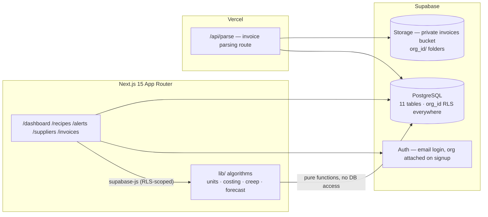

# MarginPlate

A food-cost watchdog for independent restaurants. Photograph a supplier invoice and MarginPlate extracts the line items, normalizes units, recomputes cost-per-plate across the whole menu, flags suppliers whose prices have crept up, and shows the dollar impact.

## Architecture



Design rules (hard non-negotiables in `SPEC.md`):

- **No hardcoded metrics.** Every number on screen comes from a DB query.
- **Multi-tenant by construction.** Every table carries `org_id`, has RLS enabled, an org-scoped policy, and a `set_org_id()` BEFORE INSERT trigger.
- **Algorithms are pure.** `lib/units.ts`, `lib/costing.ts`, `lib/creep.ts`, `lib/forecast.ts` contain no DB access and are covered by Vitest.

## The hard part: unit normalization

An invoice line says `1 case (24 ct) — Chicken Breast — $61.20`. The menu recipe says `0.5 lb chicken breast per plate`. The supplier's price history says `$2.85 / lb`. Three different quantities, all for the same ingredient, and the cost of the plate is only correct if every one of them is converted to the same canonical unit (`lb`) before any arithmetic happens.

The chain looks like this:

1. **Parse.** `lib/vision.ts` extracts `{ description, qty, unit, unit_price }` per line. `1 case (24 ct)` is parsed into `qty = 24, unit = each` (spec: case size parsed from the description).
2. **Convert to canonical.** `lib/units.ts` `normalize(qty, fromUnit, toUnit, unitMap)` walks the `unit_map` table — `case→each (×24)`, `lb→oz (×16)`, `kg→g (×1000)`, `oz→lb (×1/16)`, etc. It throws a typed error on an unmappable unit so bad data fails loudly instead of silently corrupting the margins. The converted quantity and the price-per-canonical-unit are stored on the `line_items` row (`canonical_qty`, `canonical_unit`, `unit_price`).
3. **Feed price history.** The canonical unit cost lands in `price_history` — that's what costing, creep, and the dashboard all read.
4. **Cost the plate.** `lib/costing.ts` `costPerPlate()` applies `yield_factor` (usable = qty × yield) on quantities **already converted to the ingredient's canonical unit**, multiplies by the canonical unit cost, and sums. Gross margin under 60% is flagged.

**Why costing is garbage without it:** if you skip step 2, you multiply a raw `case` quantity by a per-`lb` price, or an `oz` recipe component by a per-`lb` cost — the plate cost can be off by 16×, 24×, or 1000× and the app will cheerfully show you a 98% margin that doesn't exist. The unit-conversion step is what makes "cost per plate" a true number instead of a fiction. It's also why the four algorithms are pure functions with tests: the conversion is the one place where the whole model can go quietly wrong, so it's exercised at every layer (parse → price history → recipes → creep impact).

Two runtime details that bite:

- To-one joins (`ingredients`, `suppliers`) come back from PostgREST as a **single object**, while supabase-js types them as arrays. Access with `Array.isArray(x) ? x[0] : x`.
- Recipe components keep their raw `qty`/`unit`; conversion to `canonical_unit` happens in the page layer via `normalize()` against the fetched `unit_map` — never inside the pure functions.

## Stack

- Next.js 15 (App Router, TypeScript strict), Tailwind CSS
- Supabase: Postgres + Auth + Storage (RLS multi-tenant)
- Vercel for hosting
- Vitest for the algorithm suite (12 tests)
- Zod for all parsed-invoice validation

## Local setup

```bash
git clone https://github.com/Aryamanironman/marginplate
cd marginplate
npm install
cp .env.example .env.local   # fill in your Supabase project keys
npm run seed:ref             # demo org "Casa Maria": 4 suppliers, 20 ingredients,
                             # 6 recipes, 6 weeks of price history, par levels
npm run dev                  # http://localhost:3000
```

Required env vars (see `.env.example`):

| Variable | Used for |
|---|---|
| `NEXT_PUBLIC_SUPABASE_URL` | Browser client |
| `NEXT_PUBLIC_SUPABASE_ANON_KEY` | Browser client |
| `SUPABASE_URL` | Seed script + server |
| `SUPABASE_ANON_KEY` | Fallback for browser client |
| `SUPABASE_SERVICE_ROLE_KEY` | Seed script + `/api/parse` admin client |
| `VISION_API_KEY` / `VISION_MODEL` | Invoice OCR (vision provider) |

Apply the SQL migrations from `supabase/migrations/` to your Supabase project, enable email auth with confirmation OFF, and create at least one user — the RLS policies scope everything by `org_id` from the `profiles` table.

Gate before merge: `npm run typecheck && npm test && npm run build`.

Demo account (production and local after seeding): `maria@test.dev` / `DemoPass2026!`.

## Screenshots

> `docs/screenshots/` — captured on the production deployment.

- [`dashboard.png`](docs/screenshots/dashboard.png) — food-cost %, menu sorted by margin, active alerts
- [`alerts.png`](docs/screenshots/alerts.png) — price-creep feed with the arithmetic shown
- [`recipes.png`](docs/screenshots/recipes.png) — menu items with bill of materials and live margin
- [`suppliers.png`](docs/screenshots/suppliers.png) — supplier list with spend
- [`invoices.png`](docs/screenshots/invoices.png) — uploaded invoices with parse status

The demo build is seeded so every screen renders real data right after login.
